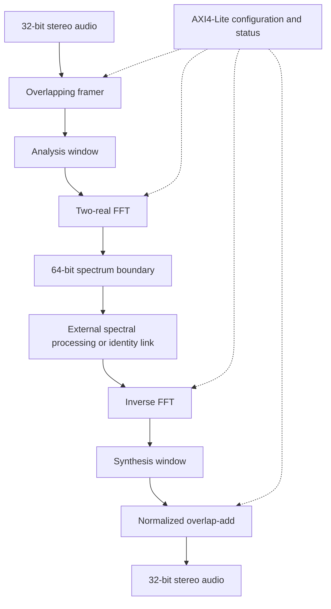

# VRM21 STFT Module FPGA

**Repository profile: B — Multi-Module DSP / Audio Pipeline.** Stereo fixed-point STFT and inverse STFT with AXI4-Stream data and AXI4-Lite control.

## Overview

Frequency-domain audio processing needs more than a standalone FFT. Continuous samples must be assembled into overlapping frames, windowed, transformed and reconstructed with consistent scaling and stream boundaries. This project combines these functions as reusable RTL analysis and synthesis IPs that can surround a spectral processor.

The design supports FFT sizes 256, 512, 1024 and 2048, hops N/2, N/4 and N/8, and periodic square-root Hann windows. The public package contains the processing hardware and testbenches; the private PYNQ application serves as a hardware test environment.

### Key Features

| Property | Implementation |
|---|---|
| Audio | Stereo signed 16-bit Q1.15 |
| Stereo transform | Two real channels packed into one complex FFT |
| Default internal components | Signed 24-bit, full scale at 2^22 |
| Coefficients | 18-bit window and twiddle components |
| FFT architecture | Iterative radix-2 DIF, natural-order output |
| Scaling | Forward DFT/N; inverse unscaled |
| Reconstruction | Windowed overlap-add with hop-dependent normalization |
| AXI data ports | 32-bit audio, 64-bit spectrum |
| Configuration | Shadow registers with atomic geometry commit |
| Packet batching | 1–16 frames per packet with the supplied wrappers |
| Monitoring | Frame, saturation and watchdog counters; sticky event flags |

## Architecture

Analysis combines overlapping framing, windowing and an iterative complex FFT shared between stereo channels through two-real packing. Synthesis applies the inverse FFT, matching window and normalized overlap-add. The wrappers provide atomic configuration, batching, counters and a progress watchdog.



The spectral stage is an integration point. The supplied integration testbench uses an identity link. The transform engines buffer frames and reuse arithmetic hardware; backpressure controls progress when a downstream stage cannot accept data.

| Module | Responsibility |
|---|---|
| `vrm_stft_axi` | Analysis wrapper, spectrum packing and batching |
| `vrm_istft_axi` | Synthesis wrapper, input saturation and packet checks |
| `vrm_stft_axil_ctrl` | Registers, configuration commit and watchdog |
| `vrm_stft` / `vrm_istft` | Analysis and synthesis processing chains |
| `vrm_stft_framer` | Sliding-frame ring buffer and overlap scheduling |
| `vrm_windowing_core` | Two-lane window multiplication, rounding and saturation |
| `vrm_fft_stream_core` | Frame loading, transform control and output streaming |
| `fft_stage_iterative` | In-place radix-2 FFT/IFFT and bit reversal |
| `vrm_overlap_add` | Accumulation, normalization and audio quantization |
| `vrm_ram_core` / `vrm_axis_skid` | Memory and stream buffering helpers |

See [architecture](docs/architecture.md) for the module hierarchy, memory organization and control flow, and [design rationale](docs/design_rationale.md) for equations and hardware trade-offs.

## Interface

- `vrm_stft_axi`: 32-bit audio input, 64-bit spectrum output.
- `vrm_istft_axi`: 64-bit spectrum input, 32-bit audio output.
- Both expose the same [AXI4-Lite register map](docs/address_map.md).
- Audio is signed Q1.15, packed as {R16,L16}.
- Wrapper spectra are {im32,re32}; default internal components are 24 bits.
- Batch B produces packets of B*N spectrum bins or B*H audio samples.

### Data Packing and Framing

| Boundary | Upper field | Lower field | `tlast` meaning |
|---|---|---|---|
| STFT audio input, 32-bit | R[15:0] | L[15:0] | Ignored; framing uses sample count |
| STFT spectrum output, 64-bit | Signed im[31:0] | Signed re[31:0] | Last bin of every B-th frame |
| iSTFT spectrum input, 64-bit | Signed im[31:0] | Signed re[31:0] | Checked against configured batch |
| iSTFT audio output, 32-bit | R[15:0] | L[15:0] | Last sample of every B-th hop |
| Direct-core spectrum, 2*DATA_W | re[DATA_W-1:0] | im[DATA_W-1:0] | Last bin of each frame |

Wrapper and direct-core spectrum layouts differ. At the default width, wrapper outputs sign-extend 24-bit components into 32-bit fields; the inverse wrapper saturates incoming components to the internal width. All N bins are transferred in natural order.

### Control and Status

The AXI4-Lite controller captures write addresses and write data independently. It permits one outstanding read and one outstanding write. Reads have no side effects; unmapped reads return zero.

| Offset | Register | Purpose |
|---:|---|---|
| `0x00` | CTRL | Enable, soft reset and commit |
| `0x04` | STATUS | Busy/running and sticky event flags |
| `0x08` / `0x0C` | FFT_N / FFT_N_ACT | Shadow / active FFT size |
| `0x10` / `0x14` | WDOG / WDOG_ACT | Shadow / active stall limit |
| `0x18` | FRAME_CNT | Completed analysis frames or synthesis hops |
| `0x1C` | SAT_CNT | Saturation event cycles |
| `0x20` | WDOG_CNT | Watchdog trips |
| `0x24` | BUSY_CYC | Last transform busy duration |
| `0x28` | ID | STFT `0x53544602`; iSTFT `0x49534602` |
| `0x2C` / `0x30` | HOP / HOP_ACT | Shadow / active hop code |
| `0x34` / `0x38` | BATCH / BATCH_ACT | Shadow / active packet batch |

Write shadow geometry, then `CTRL=5` to enable and commit. A commit flushes the processing core. See the [complete register map](docs/address_map.md) for fields, defaults and recovery behavior.

### Windowing and Reconstruction

The analysis and synthesis windows form a weighted overlap-add pair. Their squared-window overlap sum is 1, 2 or 4 for the supported hops; the overlap-add output compensates this factor. Identity reconstruction has unity gain in the steady-state mathematical model, while fixed-point quantization introduces reconstruction error.

| Hop code | H | Overlap | Contributing frames | OLA divisor |
|---:|---|---:|---:|---:|
| 1 | N/2 | 50% | 2 | 1 |
| 2 | N/4 | 75% | 4 | 2 |
| 3 | N/8 | 87.5% | 8 | 4 |

The first analysis frame requires N input samples. After priming N-H samples, each additional H samples produces one frame. Synthesis emits H audio samples per frame; startup and tail handling are explicit integration concerns.

See [latency and numeric formats](docs/latency_and_data_format.md) and [streaming contract](docs/streaming_contract.md) for alignment, normalization and DMA sizes.

## Simulation

Run the supplied SystemVerilog integration test with Vivado Simulator from a configured shell:

```powershell
powershell -ExecutionPolicy Bypass -File scripts/run_sim.ps1
```

The runner stages ROM and stimulus files under `build/sim`. The AXI testbench exercises ten scenarios spanning configuration, stream stalls, watchdog recovery, saturation and hop/batch combinations. Inspect its final `[TB] RESULT: PASS` or `[TB] RESULT: FAIL`; tool exit status alone is insufficient. Numerical golden comparison is separate from stream/control checks.

See [verification guide](docs/verification.md) for the coverage matrix, direct-core parameters, CSV outputs and acceptance criteria.

## Build

Add all `rtl/*.v` files and both coefficient `.mem` files to the synthesis project. Package the two AXI wrappers separately and connect control and AXI DMA streams. Preserve resolvable ROM paths. Board constraints and a block-design recreation script are not included.

Size DMA transfers for B*N*8 spectrum bytes and B*H*4 audio bytes. A single N=2048 spectrum frame already requires 16384 bytes; configure the DMA length width accordingly. Commit geometry while idle; commit and watchdog flushes can abort packets.

The supplied coefficients are initialized from files; this register map does not provide runtime coefficient upload. Generic helper defaults differ from the explicit settings selected by the STFT/iSTFT chains.

See [build overview](docs/build_overview.md) for top-level parameters, DMA connections, startup and recovery.

## Validation status

**FPGA-validated**, as confirmed by the maintainer for the Kria KR260. See [validation notes](docs/validation_notes.md) for evidence scope and missing measurement metadata. No new board, synthesis or timing run was performed during publication preparation.

### Repository Contents

| Path | Contents |
|---|---|
| `rtl/` | Synthesizable modules |
| `rtl/mem/` | Window and twiddle ROM initialization tables |
| `tb/` | Testbenches and AXI-Lite bus model |
| `tb/mem/` | Stereo simulation stimuli |
| `scripts/` | Vivado Simulator PowerShell runner |
| `docs/architecture.md` | Hierarchy, dataflow, transform states and memory organization |
| `docs/design_rationale.md` | Equations and reasons for the design choices |
| `docs/latency_and_data_format.md` | Fixed-point scale, packing and startup |
| `docs/address_map.md` | Register fields and control semantics |
| `docs/streaming_contract.md` | Framing, DMA sizes and finite streams |
| `docs/build_overview.md` | Synthesis and hardware integration |
| `docs/verification.md` | Simulation scenarios and acceptance |
| `docs/validation_notes.md` | Hardware-test record and evidence scope |
| `docs/limitations.md` | Supported configurations and constraints |

Python host programs, bitstreams, hardware-handoff files and rendered audio are excluded from the public package.

## License

MIT. See [LICENSE](LICENSE).

This module is part of the **VRM21 RTL Series**, a collection of reusable DSP, processor, memory and acceleration building blocks.
