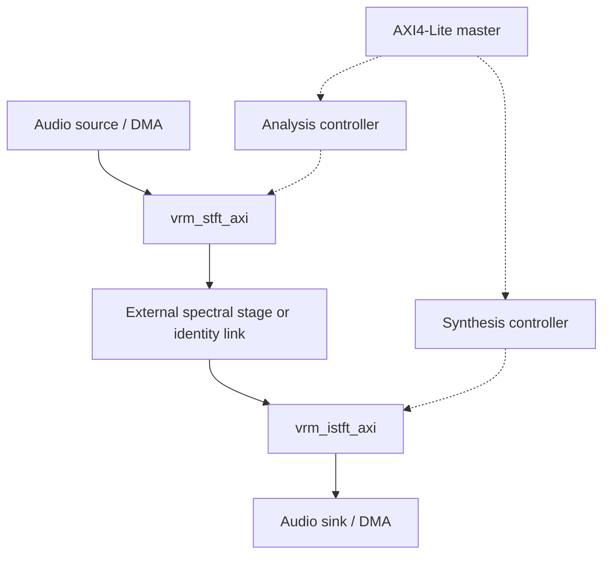
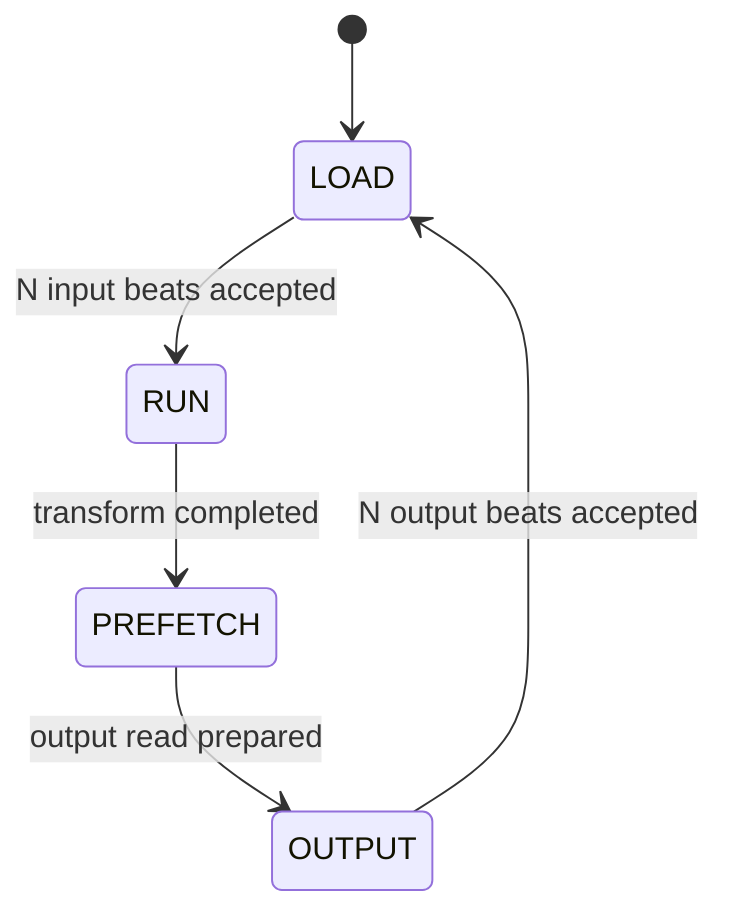

# STFT / iSTFT Architecture

## Subsystem Boundaries

The subsystem comprises two separately instantiated IPs: `vrm_stft_axi` for analysis and `vrm_istft_axi` for synthesis. Each has its own instance of `vrm_stft_axil_ctrl`, with independent configuration, counters and recovery state. The two IPs share a register layout, not a physical controller instance.

The analysis wrapper accepts continuous stereo audio and emits full complex spectra. The synthesis wrapper accepts spectra and emits reconstructed stereo hops. An external processor may operate between them; the supplied integration testbench connects the spectra through an identity path.

All interfaces inside each IP use one clock. Clock-domain conversion, DMA and processor interconnect are system-level integration responsibilities.

## Analysis Hierarchy and Dataflow

| Hierarchy | Function |
|---|---|
| `vrm_stft_axi` | Gates streams during reset/disable, packs spectra and generates batch tlast |
| `vrm_stft_axi.u_ctrl` | Maintains shadow/active geometry, watchdog and status |
| `vrm_stft_axi.u_stft` | Connects framing, windowing and FFT stages |
| `u_stft.u_framer` | Stores stereo samples and issues overlapping frames |
| `u_stft.u_win` | Applies the analysis window to both channels |
| `u_stft.u_fft` | Loads, transforms and emits each complex frame |

The framer uses a ring buffer of 2*MAX_N packed stereo words. The first frame becomes available after N accepted samples. Later frames advance by H=N>>hop_code. If the previous frame is still being issued at the next trigger boundary, input backpressure protects the pending frame.

Windowing converts signed int16 PCM to the internal scale. Lane mapping forms L+jR for a single complex transform. The FFT emits N bins in natural order. The wrapper converts the internal `{re,im}` layout to `{im32,re32}`, sign-extending each component into a 32-bit field.

The wrapper counts completed output frames and asserts tlast only on the last bin of every B-th frame. The framer's own frame count instead describes frames issued by the framing stage; these are different observation points.

## Synthesis Hierarchy and Dataflow

| Hierarchy | Function |
|---|---|
| `vrm_istft_axi` | Saturates spectrum input, checks packet boundaries and batches output hops |
| `vrm_istft_axi.u_ctrl` | Maintains independent control and status |
| `vrm_istft_axi.u_istft` | Connects inverse FFT, windowing and overlap-add |
| `u_istft.u_ifft` | Transforms one N-bin complex frame |
| `u_istft.u_win` | Applies the synthesis window |
| `u_istft.u_ola` | Accumulates overlapping frames and emits H audio samples |

Input real and imaginary fields are saturated to DATA_W. The wrapper counts N bins per frame and regenerates per-frame tlast for the inverse core. Incoming packet tlast is checked against the configured batch; it does not determine transform length.

The inverse FFT is unscaled in the STFT configuration. Its real and imaginary output lanes represent left and right time-domain signals. After synthesis windowing, overlap-add compensates the overlap gain and quantizes to signed int16 audio. The wrapper asserts output tlast at the end of every B-th hop.

## Transform Engine and Memory

Each analysis/synthesis transform instance contains a `vrm_fft_stream_core`, an `fft_stage_iterative` engine, frame RAM and twiddle ROM. Analysis and synthesis use separate hardware instances; arithmetic is reused within each engine.

The iterative engine performs radix-2 decimation-in-frequency butterflies, reuses a multiplier for complex products and finishes with in-place bit reversal. The stream wrapper does not overlap loading the next frame with emitting the current frame. Stream stalls extend wall-clock execution without changing accepted-beat ordering.

| Storage | Organization at supplied defaults | Purpose |
|---|---|---|
| Analysis ring | 4096 x 32-bit | Overlapping stereo source frames |
| FFT frame RAM, per transform | 2048 x 48-bit | In-place complex data |
| Twiddle ROM, per transform | 1024 x 36-bit | Packed signed 18-bit real/imaginary coefficients |
| Window ROM, per window stage | 2048 x 18-bit | Unsigned window coefficients |
| OLA accumulator | 2048 x 54-bit logical stereo words | Two 27-bit accumulation lanes |

These are logical RTL storage dimensions, not measured BRAM utilization. Mapping and replication depend on synthesis. For smaller runtime transforms, the supplied maximum-size coefficient tables are addressed with the corresponding stride.

## Overlap-Add Operation

The accumulator tracks N sample positions in a circular buffer. A frame adds its N windowed values to the current positions. The first H sums are complete, so they are emitted and cleared; remaining sums stay for later frames. The circular pointer advances by H.

The first frame after flush masks old RAM contents instead of clearing the whole memory. The first N/H-1 output hops have incomplete overlap. Final audio conversion includes the internal-to-PCM shift and an additional hop-dependent normalization shift.

## Control, Reset and Observability

Each controller validates FFT_N, HOP and BATCH as one geometry update. A valid commit applies all three; an invalid commit retains active geometry and sets a flag. Watchdog settings apply on every commit. Both accepted and rejected commits flush processing state.

Soft reset, commit and watchdog recovery reset internal stream/framing state. They can abort a packet; DMA recovery and analysis re-priming must be coordinated by the integrator. Ordinary backpressure preserves data, while these explicit recovery operations discard pending data.

FRAME_CNT observes accepted output frame/hop completions. SAT_CNT observes combined saturation events. BUSY_CYC records transform busy duration and excludes frame collection/output stalls. STATUS busy therefore describes the transform engine, not complete subsystem emptiness.

See [register semantics](address_map.md), [streaming contract](streaming_contract.md), [numeric formats](latency_and_data_format.md) and [design rationale](design_rationale.md) for the corresponding integration details.
